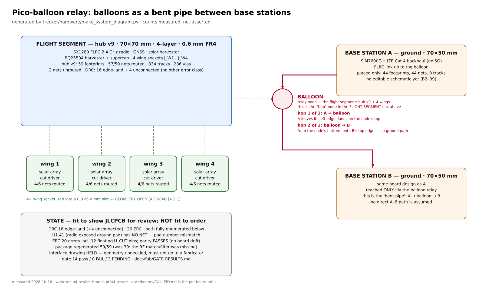

# Pico-Balloon Tracker & E80 Range Test Bench

**A pico-balloon relay system: balloons acting as a bent pipe between base stations.**



A flight hub carries a 2.4 GHz FLRC radio, GNSS and a solar harvester, and carries four solar wings. Two
ground base stations reach each other **only through the balloon** — there is no ground-to-ground path.
Each base station has 4G/5G backhaul.

**This README has two parts.** The relay system (below) is the current programme. The E80-STM32 range
test bench further down is the bench instrumentation used to characterise the radio link.

---

## 🛰 The relay system

### Board status

**Generated** — `docs/boards/GALLERY.md` has renders and a measured table. Regenerate with
`python3 tracker/hardware/make_board_gallery.py`.

| board | footprints | nets routed | tracks | what it is |
|---|---|---|---|---|
| **hub v9** | 59 | **57 / 59** | 834 | flight hub: SX1280 FLRC, GNSS, solar harvester, 4 wing sockets |
| **wing v9** | 15 | **4 / 6** | 20 | wing solar array + cut driver + hub tab |
| **base station** | 44 | **0 / 44** | 0 | ground: SIM7600E-H 4G/5G, FLRC to the hub |

Read the `nets routed` column, **not** the amount of copper in a render — a copper pour is not routing.

### Start here by goal

| I want to… | read |
|---|---|
| see the fabrication questions we are asking a fab | [`docs/fab/JLC-QUERY-DRAFT-MESSAGE.md`](docs/fab/JLC-QUERY-DRAFT-MESSAGE.md) |
| see the fab-review reading order | [`docs/fab/README.md`](docs/fab/README.md) |
| see where every gate stands | [`docs/fab/GATE-RESULTS.md`](docs/fab/GATE-RESULTS.md) |
| see what is still missing | [`docs/fab/ASTRA-GAP-ANALYSIS.md`](docs/fab/ASTRA-GAP-ANALYSIS.md) |
| see per-board renders + measured state | [`docs/boards/GALLERY.md`](docs/boards/GALLERY.md) |
| read the wing interface decision record | [`docs/adr/046-wing-board-interface.md`](docs/adr/046-wing-board-interface.md) |

### ⚠️ Honest state

**Fit to show a fabricator for review. Not fit to order.** Open items:

- **`U1.41`** — the radio's exposed ground pad **has no net** (pad-number mismatch)
- **ERC: 20 errors** — incl. 12 floating `U_CUT1–4` pins; **parity passes**, so the board has not drifted
- **DRC: 16 errors — all 16 are the intentional `J_W*` edge lands. Zero real electrical errors.** The 137
  warnings are silkscreen or library metadata
- **Wing joint geometry is OPEN** (ADR-046 §4.2.1) — so the interface drawing is **held**
- **Base station: 0 of 44 nets routed**, no editable schematic

### Generate the artefacts

```bash
python3 tracker/hardware/make_board_gallery.py      # renders + the measured table
python3 tracker/hardware/make_system_diagram.py     # the diagram above
bash    tracker/hardware/run_erc.sh                 # ERC + schematic-to-board parity
bash    tracker/hardware/fab_grade.sh tracker/hardware/hub_board_v9.kicad_pcb tracker/hardware/output/fabgrade
~/venvs/kicad/bin/python tracker/hardware/tests/test_netlist_integrity.py
```

All three gates are recorded in [`docs/fab/GATE-RESULTS.md`](docs/fab/GATE-RESULTS.md).

### Visual review — how artefacts are checked here

A visual consultant (`gpt-6-astra`) reviews every generated diagram before it is committed:

```bash
python3 tracker/hardware/ask_astra.py --review artefact.png --out review.md
```

**This is not decoration.** It has caught two architecture errors in the system diagram alone — a
one-base-station topology that could not depict a relay, and a wiring path that drew the direct
ground-to-ground link its own label denied. Both survived reading the generator code. See
[`docs/fab/reviews/`](docs/fab/reviews/).

**Regenerate before reviewing.** Reviewing a stale render is reviewing a file that no longer exists.

---

## 🧪 E80-STM32 range test bench

Ultralight (<15 g) pico-balloon tracker (ESP32-C3 + Semtech LR2021) with a
dedicated **E80-STM32 bench firmware** for distributed LoRa/FLRC range
testing.  Two boards, two laptops, one `make` command each — that's all
it takes to run a full PER / RSSI / SNR sweep.

---

## ⚡ Getting Started

```bash
git clone https://github.com/felixfelix-bot/balloon-fresh.git
cd balloon-fresh/firmware/e80-stm32-bench
git checkout feat/2g4-sweep

# One-time: flash the board (needs both USB cables connected)
make flash

# On the TX machine:
make tx

# On the RX machine (within 4 minutes of `make tx`):
make rx

# After both finish, merge logs:
make range-merge RX=rx-log.csv TX=tx-log.csv
```

**That's it.** The system auto-detects serial ports, computes a synchronised
start time (T0), beeps a countdown, and writes results to CSV.

> **Want the minimal package?** Download the pre-built
> [range-test ZIP](../../releases) — contains only the files you need to
> flash + run TX/RX. See [Part 4](#4-minimal-range-test-zip) below.

---

## 📋 Table of Contents

| # | Section |
|---|---------|
| 1 | [What is this repo?](#1-what-is-this-repo) |
| 2 | [Hardware Requirements](#2-hardware-requirements) |
| 3 | [Quick Start (Linux / macOS / Windows)](#3-quick-start) |
| 4 | [Minimal Range-Test ZIP](#4-minimal-range-test-zip) |
| 5 | [Repository Structure](#5-repository-structure) |
| 6 | [Key Documentation](#6-key-documentation) |
| 7 | [Tools Reference](#7-tools-reference) |
| 8 | [Config Presets](#8-config-presets) |
| 9 | [Development & Testing](#9-development--testing) |
| 10 | [Hardware](#10-hardware) |

---

## 1. What is this repo?

This repository hosts **two related projects**:

1. **Pico-Balloon Tracker** — An ESP32-C3 + Semtech LR2021 ultra-light
   balloon tracker (<15 g) with multi-band LoRa (2.4 GHz + Sub-GHz), FLRC
   high-speed mode, 3D PCB-Yagi antenna array, solar/supercap power, and
   BMP280 sensing.

2. **E80 Range Test Bench** — A STM32F103C8T6 based firmware (`firmware/e80-stm32-bench/`)
   for the E80-900MBL-02 board, used for distributed LoRa/FLRC range
   testing.  Measures PER, RSSI, SNR, and bit error rate across modulation
   schemes at various distances.  Two boards act as TX/RX, each connected
   to a separate computer.  Role is set at runtime — boards are
   interchangeable.

---

## 2. Hardware Requirements

| Item | Qty | Notes |
|------|-----|-------|
| E80-900MBL-02 board | 2 | One per machine. Boards are interchangeable (TX/RX is software-selected). |
| Computer (laptop/mini PC) | 2 | One per board. Linux, macOS, or Windows. |
| USB cables | 2 per board | CH340 USB-serial (data) + CMSIS-DAP/Pico SWD probe (debug). Both required. |
| Phone with GPS | 1 (opt.) | For distance measurement. Any app that exports GPX/KML. |

### E80 Board Anatomy

- **STM32F103C8** — microcontroller (64 KB flash / 20 KB RAM)
- **LR2021** — Semtech LoRa Gen 4 radio (supports LoRa + FLRC)
- **CH340** — USB-serial chip for host communication
- **Raspberry Pi Pico** (CMSIS-DAP) — SWD probe for flashing + board reset

### Pico-Balloon Hardware

| Component | Spec |
|-----------|------|
| MCU | ESP32-C3 (ESP-C3-12F / XIAO ESP32C3) |
| LoRa | Semtech LR2021 (Gen 4) / LR1121 (Gen 3 alt.) |
| PA/LNA | Skyworks SKY66112-11 (+22 dBm TX, +14 dB LNA RX) |
| Antennas | 4× PCB-Yagi + SP4T switch (lighthouse mode) |
| Power | 12× solar cells → BAT54 → 2× 3.3 F supercaps → TPS7A02 LDO |
| Sensor | BMP280 (pressure/temperature) |
| Target weight | <15 g |

---

## 3. Quick Start

### Linux

```bash
# Install toolchain
sudo apt install cmake arm-none-eabi-gcc openocd python3 python3-pip
pip install pyserial

# Clone & build
git clone https://github.com/felixfelix-bot/balloon-fresh.git
cd balloon-fresh/firmware/e80-stm32-bench
git checkout feat/2g4-sweep

# Add user to dialout group (needed for serial port access)
sudo usermod -aG dialout "$USER"
# Log out and back in, or: newgrp dialout

# Flash firmware (first time only — both USB cables connected)
make flash
```

### macOS

```bash
# Install toolchain
brew install cmake gcc-arm-embedded openocd python3
pip3 install pyserial

# Clone & build
git clone https://github.com/felixfelix-bot/balloon-fresh.git
cd balloon-fresh/firmware/e80-stm32-bench
git checkout feat/2g4-sweep

make flash
```

### Windows

1. Install [STM32CubeIDE](https://www.st.com/en/development-tools/stm32cubeide.html)
   or a standalone `arm-none-eabi-gcc` toolchain.
2. Install [OpenOCD](https://gnutoolchains.com/arm-eabi/openocd/).
3. Install [Python 3](https://www.python.org/downloads/) + `pip install pyserial`.
4. Clone the repo, open a terminal (Git Bash or PowerShell) in
   `firmware/e80-stm32-bench/`.
5. Run `make flash`.

### Running a Test

```bash
# On TX machine:
make tx

# On RX machine (within 4 minutes of make tx):
make rx

# After both finish (either machine):
make range-merge RX=rx-log.csv TX=tx-log.csv
```

> For full instructions including flashing details, serial port detection,
> GPS stitching, and troubleshooting, see the
> **[E80 Range Test Operator Guide](firmware/e80-stm32-bench/docs/RANGE-TEST-GUIDE.md)**.

---

## 4. Minimal Range-Test ZIP

For operators who just want the files needed to flash + run TX/RX without
cloning the whole repo:

**Download:** See [GitHub Releases](../../releases) for `e80-range-test-*.zip`.

**Build your own:**

```bash
cd firmware/e80-stm32-bench
bash tools/create-range-test-zip.sh
# Output: e80-range-test-<sha7>.zip
```

The ZIP contains:

| Path | Description |
|------|-------------|
| `Makefile` | Convenience targets (flash, tx, rx, merge) |
| `CMakeLists.txt` | Firmware build config |
| `cmake/` | Toolchain file (arm-none-eabi) |
| `ld/` | Linker scripts (STM32F103C8) |
| `src/` | Firmware source code |
| `third_party/` | STM32 HAL + Semtech LR2021 driver |
| `tools/e80_bench_ctl.py` | Board controller — TX/RX, PER bench |
| `tools/e80_detect.py` | Auto-detect board serial port |
| `tools/gps_stitch.py` | Stitch GPS track onto RX packet log |
| `tools/merge_csvs.py` | Merge TX + RX logs into PER report |
| `tools/countdown.py` | Countdown timer with beeps |
| `configs/envelope-4cfg-max.json` | Default range test preset (4 configs, max payload) |
| `configs/outdoor-10.json` | Outdoor range test preset (10 pkts per config) |
| `docs/RANGE-TEST-GUIDE.md` | Full operator guide |
| `README-RANGE-TEST.txt` | Quick start card |

---

## 5. Repository Structure

```
balloon-fresh/
├── firmware/
│   ├── e80-stm32-bench/          # E80 STM32 range test firmware
│   │   ├── Makefile              # Flash, tx, rx, merge targets
│   │   ├── CMakeLists.txt        # Firmware build config
│   │   ├── src/                  # Firmware source (bench, radio, console)
│   │   ├── tools/                # Python tools (comms, GPS, CSV, sweep)
│   │   ├── cmake/                # ARM cross-compile toolchain
│   │   ├── ld/                   # STM32 linker scripts
│   │   ├── third_party/          # STM32 HAL + Semtech LR2021 driver
│   │   ├── docs/                 # RANGE-TEST-GUIDE, flashing, timing analysis
│   │   ├── tests/                # Host-side unit tests (C unit + pytest)
│   │   └── FLASHING.md           # Flashing procedures
│   ├── esp32-c3-flrc/            # ESP32-C3 FLRC bench firmware
│   ├── esp32-bootsel-controller/ # ESP32 boot/select controller
│   ├── esp32-uart-bridge/        # UART bridge firmware
│   ├── rp2040-flrc-max/          # RP2040 FLRC tests
│   └── scripts/                  # Build/deploy scripts
├── mesh-stack/                   # ESP-NOW mesh + FLRC bench + LR2021 drivers
├── hardware/                     # PCB design (KiCad), enclosures
├── configs/                      # Range test config presets (JSON)
├── tools/                        # Shared repo-wide tools & scripts
├── docs/                         # Project documentation, ADRs, plans
├── data/                         # Captured test data & analysis
├── tests/                        # Integration tests
├── bom/                          # Bill of materials
├── ansible/                      # Deployment playbooks (range-setup)
├── scripts/                      # Repo-wide automation scripts
└── tracker/                      # Ground station & tracker firmware
```

---

## 6. Key Documentation

| Document | Description |
|----------|-------------|
| **[Harmonized Cross-Board Bench Package](docs/harmonized/HARMONIZED-BENCH-PACKAGE.md)** | Entry point for cross-board (E80 / ESP32 / RP2040) bench work — real repo URLs and branches, build/flash per family, running a session, handing data back |
| [Harmonized Results](docs/harmonized/HARMONIZED-RESULTS.md) | Results summary by board-pair × band × LEN × BR, with raw CSV links; 868 MHz baseline vs 2.4 GHz semantics |
| [Harmonized Run Report Template](docs/harmonized/HARMONIZED-RUN-REPORT-TEMPLATE.md) | Fill-in template for one harmonized run (identity, provenance, matrix, acceptance, results, anomalies) |
| [Bench Console Spec](docs/BENCH-CONSOLE-SPEC.md) | Normative cross-board console protocol (`ID?/SET/N/PKT/STAT?`, framing, bands) |
| **[E80 Range Test Guide](firmware/e80-stm32-bench/docs/RANGE-TEST-GUIDE.md)** | Complete self-contained operator guide — hardware setup, flashing, TX/RX, merge, GPS, troubleshooting |
| [E80 Flashing Guide](firmware/e80-stm32-bench/FLASHING.md) | Detailed flashing procedures (SWD, stm32flash) |
| [Timing Tolerance Analysis](firmware/e80-stm32-bench/docs/timing-tolerance-analysis.md) | T0 sync mechanism analysis |
| [Hardware Integration Findings](firmware/e80-stm32-bench/docs/hardware-integration-findings.md) | Live hardware test results |
| [Operator Quickstart](firmware/e80-stm32-bench/tools/OPERATOR-QUICKSTART.md) | Quick reference for command structure |
| [ADR Index](docs/adr/) | Architecture Decision Records |
| [Hardware Connections](HARDWARE_CONNECTIONS.md) | Board wiring reference |

---

## 7. Tools Reference

| Tool | Location | Purpose |
|------|----------|---------|
| `e80_bench_ctl.py` | `firmware/e80-stm32-bench/tools/` | Main board controller — TX burst, RX arm, PER measurement, sweep runner |
| `e80_detect.py` | `firmware/e80-stm32-bench/tools/` | Auto-detect E80 board role + serial port (handles CH340 port swapping) |
| `gps_stitch.py` | `firmware/e80-stm32-bench/tools/` | Stitch GPS track points onto RX packet log by nearest timestamp |
| `merge_csvs.py` | `firmware/e80-stm32-bench/tools/` | Merge TX + RX logs into PER report (joins on session/config/pkt_idx) |
| `countdown.py` | `firmware/e80-stm32-bench/tools/` | Countdown to T0 with terminal bell beeps |
| `e80_sweep_full.py` | `firmware/e80-stm32-bench/tools/` | Full modulation sweep (FLRC + LoRa at multiple bitrates/SF) |
| `create-range-test-zip.sh` | `firmware/e80-stm32-bench/tools/` | Build minimal ZIP package for range test operators |

---

## 8. Config Presets

Config files live in `configs/` at the repo root:

| File | Description |
|------|-------------|
| `outdoor-10.json` | Outdoor range test — 10 pkts per config, 868 MHz EU SRD |
| `indoor-baseline.json` | Indoor baseline test |

Each JSON config specifies a list of modulation configurations:

```json
{
  "label": "FLRC-650 LEN64",
  "mod": "flrc",
  "br": 650,
  "pa": 10,
  "freq": 868000000,
  "plen": 64,
  "gap": 5000,
  "n_pkts": 10
}
```

Fields: `mod` (flrc/lora), `sf` (LoRa spreading factor), `bw` (bandwidth kHz),
`br` (bitrate kbps), `pa` (TX power dBm), `freq` (Hz), `plen` (payload bytes),
`gap` (inter-packet gap ms), `n_pkts` (packets per config).

---

## 9. Development & Testing

```bash
# Firmware build
cd firmware/e80-stm32-bench
make firmware          # Cross-compile with arm-none-eabi-gcc

# Host unit tests (uses system gcc)
make test-host

# Run pytest suite
cd firmware/e80-stm32-bench/tools
python3 -m pytest ../tests/ -v

# Run a dry-run of the range test (prints schedule, no hardware)
make range-dry-run
```

---

## 10. Hardware

| Directory | Description |
|-----------|-------------|
| `hardware/` | PCB design files (KiCad), enclosure CAD |
| `bom/` | Bill of materials |
| `docs/pcb/` | PCB design documentation |
| `docs/hardware-reference/` | Hardware reference materials |

---

## License

See individual source files and `firmware/e80-stm32-bench/third_party/`
for licensing details. Third-party drivers retain their original licenses
(Semtech BSD, ST BSD-3-Clause).

## Cross-Board Bench — dieser Branch (`range-tests`)
Dieser Branch ist die Range-Test-Spur der harmonisierten Cross-Board-Messungen
(E80 STM32+LR2021 / ESP32-C3+LR2021 / RP2040+LR2021). Einstiegspunkt für alles
Weitere ist `docs/harmonized/HARMONIZED-BENCH-PACKAGE.md` im Branch **`main`** desselben
Repos (`https://github.com/felixfelix-bot/balloon-fresh.git`).
> **Wichtig — die Bench-Console liegt NICHT auf diesem Branch.**
> `tools/balloon_sweep.py` und `docs/BENCH-CONSOLE-SPEC.md` gibt es nur auf
> `main` (HARM-Kette, `harm/t5-bench-console`). Auf `range-tests` schlägt
> `ls tools/balloon_sweep.py` fehl. Wer die harmonisierte Console fahren will,
> muss `main` auschecken oder diesen Branch damit mergen; die untenstehenden
> Kommandos sind die *Legacy*-Sweep-Werkzeuge dieses Branches.
### RP2040-Firmware bauen/flashen (dieser Branch)
cd firmware/rp2040
make build-tx        # bzw. build-rx / build-both
make flash-tx        # bzw. flash-rx / flash-both
make monitor-tx      # bzw. monitor-rx
make ports           # Ports neu ermitteln (nicht raten)
### Sweep fahren (Legacy-Weg dieses Branches)
# Board-Mutex ist Pflicht — niemals ohne Lock flashen
BALLOON_TRACK=range-tests python3 ~/repos/balloon-fresh/tools/balloon-board-lock.py \
    acquire board-a --purpose "range sweep" --timeout 120
python3 tools/sweep_flash.py          # flashen
python3 tools/sweep_capture.py 480    # 480 s erfassen (>= 2 Zyklen)
python3 tools/capture_sweep.py        # alternativ: Sweep-Capture
BALLOON_TRACK=range-tests python3 ~/repos/balloon-fresh/tools/balloon-board-lock.py release board-a
Die Ergebnisse und die bekannten Fallstricke dieses Ansatzes (Timing-Drift
zwischen zwei freilaufenden RP2040, Slot-Weiten, IRQ-/RSSI-Opcode-Bugs) stehen in
`docs/bench/SWEEP-RESULTS.md`. Datenübergabe-Konvention dieses Branches:
`docs/data-handover/DATA-HANDOVER-2026-08-17.md`.
### Harmonisierte Session (nur auf `main`)
git checkout main     # Console liegt dort
python3 tools/balloon_sweep.py --tx rp2040 --rx esp32 --session <yymmddHHMM> --dry-run
`REFUSED (pre-hardware, spec enforcement): …` heisst: der Plan verletzt die Spec
(LEN-Cap 255/511, GAP >= 40 000 us bei LEN > 256, Frequenz-Paar). Plan
korrigieren, nicht umgehen. 2.4-GHz-Cross-Board ist nur RP2040<->ESP32 erlaubt.
