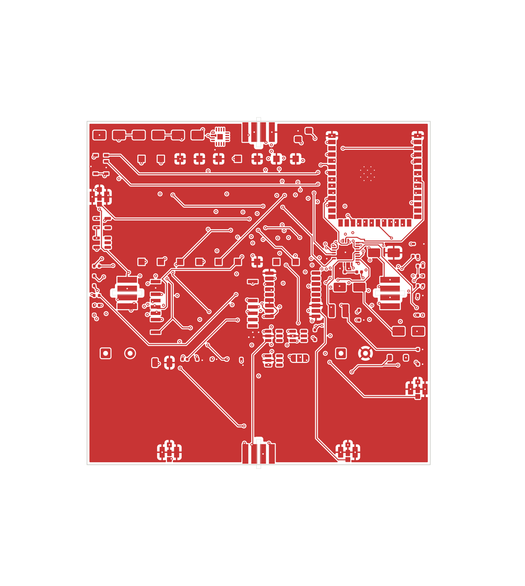
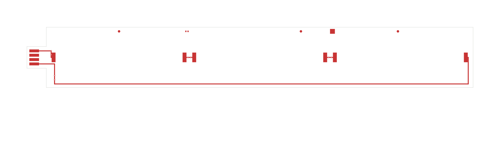
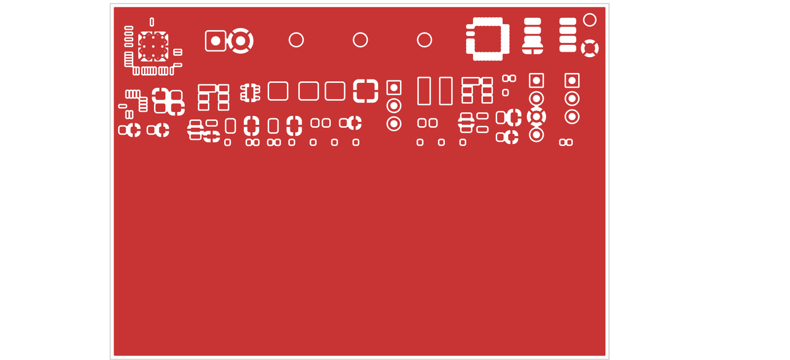

# Board gallery

**Generated** by `tracker/hardware/make_board_gallery.py` — do not edit by hand. Regenerate
with:

```bash
python3 tracker/hardware/make_board_gallery.py
```

Every number below is read from the board file at generation time. A hand-maintained status
table drifts; this one cannot.

| board | render | footprints | nets routed | tracks | vias | outline |
|---|---|---|---|---|---|---|
| **hub v9** |  | 59 | 59/59 | 991 | 290 | 70.0×70.0 mm |
| **wing v9** |  | 15 | 4/6 | 20 | 8 | 184.0×25.0 mm |
| **base station** |  | 44 | 0/44 | 0 | 0 | 70.0×50.0 mm |

## What each board is

- **hub v9** — flight hub: 4 wing sockets, SX1280 FLRC radio, GNSS, solar harvester
  - `tracker/hardware/hub_board_v9.kicad_pcb`  sha256 `374132814682a432…`
- **wing v9** — wing solar array + cut driver + hub tab
  - ⚠️ **2 net(s) unrouted**
  - `tracker/hardware/wing_board/wing_board_v9.kicad_pcb`  sha256 `34f103774bfba921…`
- **base station** — ground station: LTE Cat 4 via SIM7600E-H (no 5G), FLRC link to the hub
  - ⚠️ **44 net(s) unrouted**
  - `tracker/hardware/base_station/base_station_v1_placed_v2.kicad_pcb`  sha256 `095d0278410465f2…`

## Notes

- **A copper pour is NOT routing.** The base-station render shows a large copper fill
  across the board, and its `nets routed` column reads `0/44`. Both are correct and they
  are not in conflict: a ground/supply **zone** is not a routed **track**. A visual review
  of these renders raised exactly this and warned that copper coverage alone *"does not
  establish that the intended nets are connected"*. Read the `nets routed` column, not the
  amount of red.
- Renders are `F.Cu` + `Edge.Cuts`, exported with `--exclude-drawing-sheet` so KiCad's page
  frame and title block do not overlay the board, and with the frame widened around the
  board so the outline sits inside the image with a clear margin on all four sides. Inner and
  back layers are not shown here;
  see `docs/fab/reviews/` for per-layer plots and their review.
- **A render shows geometry, not correctness.** Clearance, impedance and netlist correctness
  are measured by the gates in `docs/fab/GATE-RESULTS.md`. A visual review of these three
  images confirmed that electrical correctness cannot be judged from any of them.
- The base station's `0` routed nets is the single largest gap in the system; see
  `docs/fab/ASTRA-GAP-ANALYSIS.md`.
- Regenerate this gallery after ANY board change: `python3
  tracker/hardware/make_board_gallery.py`. The numbers are read at generation time, so a
  stale gallery is possible if this is skipped.
